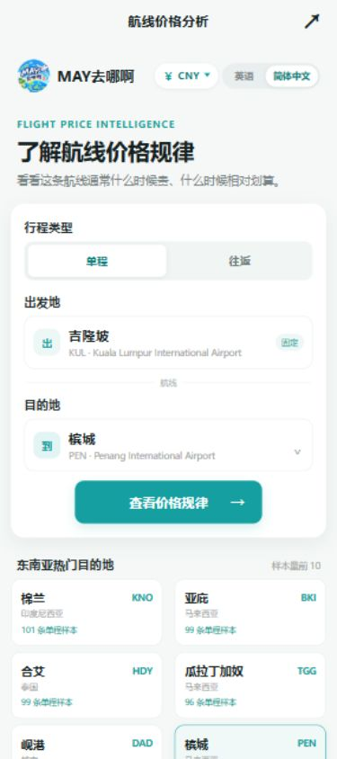

# MAY去哪啊 · Flight Destination

**面向吉隆坡出发旅客的东南亚航线价格分析项目。** 通过微信小程序与移动端网页，探索公开报价样本中的价格分布、出行日期和航线差异。

[在线体验](https://may-flight-trends.spicytern512.chatgpt.site) · [快速运行](docs/GETTING-STARTED.md) · [架构与实现](docs/ARCHITECTURE.md) · [数据说明](docs/DATA.md) · [更新记录](CHANGELOG.md) · [MIT 许可证](LICENSE)

> 招聘方快速浏览：打开在线体验，切换单程/往返，搜索目的地，再进入价格分析页。网页版采用移动端布局，桌面浏览器也可直接打开。

## 功能

- **航线探索**：吉隆坡出发的东南亚目的地，支持中文、拼音和机场代码搜索，以及样本量排行榜。
- **价格分析**：单程与往返数据独立，展示价格分布、日期与星期等描述性统计；无样本时显示缺失状态。
- **数据融合**：将内置样本与云端公开报价合并，按来源与行程识别重复记录。
- **多语言与币种**：中英文界面及多币种显示；保留报价原币种，汇率采用有日期的参考快照。
- **定时采集**：Cloudflare Worker + KV；北京时间每日 00:00 运行，来源页面按七天轮换检查。
- **网络恢复**：首页报价和排行榜失败后自动重试；页面隐藏或卸载时清理重试定时器。

## 页面预览



*预览图为 2026-10-27 的界面记录；当前版本以代码与在线演示为准。*

## 技术栈与工程实现

| 层次 | 实现 |
| --- | --- |
| 微信小程序 | JavaScript、WXML、WXSS，分析页按分包加载 |
| 独立网页版 | 原生 JavaScript、HTML/CSS，轻量模板与微信接口适配层 |
| 构建 | Node.js 脚本，将网页版自身源码打包为静态资源 |
| 公共报价服务 | Cloudflare Workers、Workers KV、Cron Triggers |
| 数据分析 | Node.js 数据校验、去重、统计与离线模块生成 |

值得查看的实现：

- [首页请求恢复与状态管理](pages/index/index.js)
- [离线样本索引与云端合并](utils/sample-index.js)
- [实时航线统计](price-intelligence/live-route-analysis.js)
- [分析页与图表](price-intelligence/pages/insights/insights.js)
- [网页运行适配层](web/dist/mobile.js)
- [独立网页打包脚本](web/build-mobile.cjs)
- [公共页面采集 Worker](cloudflare-worker/worker.js)

## 本地体验

需要 Node.js。构建不需要安装第三方 npm 依赖。

```bash
node web/build.cjs
```

将 `web/dist/` 作为静态目录提供服务。例如安装了 Python 时：

```bash
python -m http.server 8000 --directory web/dist
```

在浏览器访问 `http://localhost:8000`。微信小程序导入和后端部署见[快速运行指南](docs/GETTING-STARTED.md)。

## 仓库结构

```text
app.* / pages/ / utils/ / assets/   微信小程序
price-intelligence/                数据样本、分析脚本和来源文档
cloudflare-worker/                 公开页面报价采集服务
web/source/                        网页版独立维护的源码副本
web/dist/                          可直接发布的静态网页
web/build*.cjs                     网页打包入口
archives/                         2026-10-27 历史源码归档
docs/                            运行、架构与数据说明
```

小程序与网页版独立维护；当前网页版于 2026-11-03 同步小程序首页进度。构建只读取 `web/source/`，不会读取上级小程序源码。`archives/` 为历史参考，不代表当前实现；排查和修改请优先查看根目录及 `web/`。

## 数据范围与局限

本项目用于分析公开页面样本，**不提供订票，也不保证报价当前可购买**。采集可能因网页结构、访问限制或缺少明确日期而返回零条结果。页面自述订单记录没有经过独立交易核验；不绕过登录或验证码。

样本来源、采集日期和汇率口径见[数据说明](docs/DATA.md)。不将单程报价复用为往返报价，不把少量样本描述为最优购票时机。仓库不含完整聊天记录、线上 KV 数据或开发者账号凭据。

## 许可与贡献

项目代码使用 [MIT License](LICENSE)。第三方公开报价、来源页面及品牌资源的权利仍归各自权利人；MIT 不代表对第三方内容授予额外许可。提交改动前请阅读 [CONTRIBUTING.md](CONTRIBUTING.md)。
