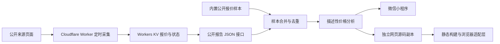

# 架构与实现

图中合并和分析代码在两端各自运行，网页版使用 `web/source/` 副本，没有运行时跨目录依赖。

## 数据处理

原始样本保存来源、行程日期、采集日期、价格和原币种。单程与往返有独立数据集。离线脚本生成微信可加载的模块，运行时再合并云端报告。统计结果用于描述已采集样本，并不预测或保证未来成交价。

## 网页适配

`web/build-mobile.cjs` 从本项目 source 递归收集 CommonJS 模块、模板和样式，生成 `dist/mini-bundle.js` 和页面 CSS。`dist/mobile.js` 负责模板渲染、事件、浏览器存储、请求、页面跳转、Canvas 与分享链接复制。

网页版当前提供首页和分析页；根目录还保留小程序其他页面，不应理解为网页版覆盖了所有小程序流程。适配层不是通用微信运行时，只实现本项目需要的接口。

## 恢复与生命周期

首页请求使用刷新参数并在失败后进行两次延迟重试（1.5 秒、5 秒）。请求编号避免过期回调覆盖新选择；页面隐藏和卸载时停止重试。浏览器适配层使用页面代次，阻止旧页面请求回写。

## 边界

`cloudflare-worker/` 是小程序服务源码；`web/source/cloudflare-worker/` 是独立副本，内容可能有差异。上传本仓库不自动部署它们。公开副本已移除 Sites 项目标识，并将微信 AppID 替换为占位符；不包含部署凭据、Git 历史或线上数据。
